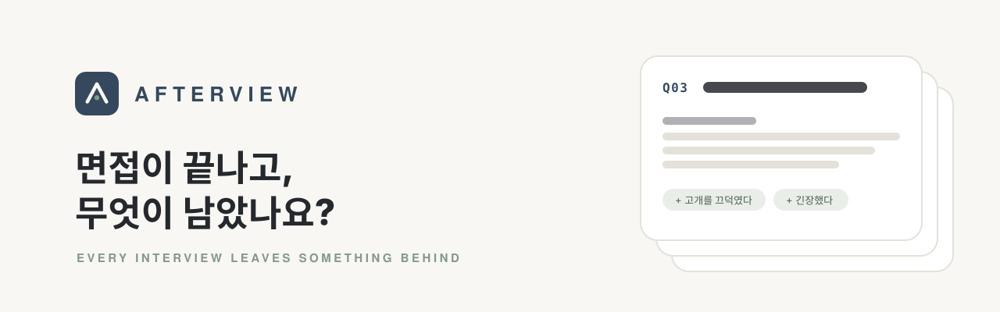
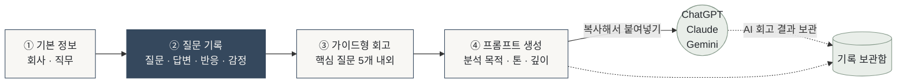

<div align="center">



### 면접이 끝난 뒤, 기억을 기록으로. 기록을 다음 기회로.

면접에서 받은 질문과 답변, 면접관의 반응을 빠르게 기록하고<br/>
ChatGPT · Claude · Gemini에 바로 붙여넣을 수 있는 **AI 회고 프롬프트**로 정리해 주는 웹 서비스

<br/>

**[🔗 지금 사용해 보기](https://csicho92-ui.github.io/afterview/)**

<br/>

[](https://github.com/csicho92-ui/afterview/actions/workflows/deploy.yml)


</div>

<br/>

## 왜 만들었나요

면접장을 나서는 순간부터 기억은 빠르게 흐려집니다. 집에 도착할 즈음이면 *"그 질문에 내가 뭐라고 했더라?"* 부터 헷갈리고, 면접관이 고개를 끄덕였는지, 내가 왜 당황했는지 같은 맥락은 거의 남지 않습니다.

AI에게 피드백을 받으려 해도 면접 상황을 처음부터 설명해야 하고, 두서없이 적으면 분석도 두루뭉술해집니다. 기존 면접 서비스는 대부분 **면접 전**의 예상 질문과 모범 답변에 집중합니다.

**AFTERVIEW는 면접이 끝난 뒤에 집중합니다.** 흩어진 기억을 질문 단위로 구조화하고, AI가 사실에 근거해 분석할 수 있는 프롬프트로 바꿔 줍니다.

> AFTERVIEW는 합격 여부를 예측하는 서비스가 아닙니다.
> 다음 면접에서 무엇을 바꿀지 찾도록 돕는 **면접 회고 프롬프트 빌더이자 개인 커리어 아카이브**입니다.

<br/>

## 어떻게 동작하나요



질문 세 개 정도라면 **10분 안에** 첫 회고를 받을 수 있습니다.

<br/>

## 주요 기능

| | 기능 | 설명 |
| :-: | --- | --- |
| ✍️ | **질문 카드 기록** | 질문 · 실제 답변 · 면접관 반응 · 당시 감정 · 아쉬운 점을 카드 하나에. 접히는 아코디언이라 질문이 10개를 넘어도 깔끔합니다. |
| ⚡ | **빠른 입력** | "고개를 끄덕였다", "긴장했다" 같은 버튼을 누르기만 하면 문장이 채워집니다. `Ctrl/⌘ + Enter`로 다음 질문을 바로 추가. |
| 🧭 | **가이드형 회고** | 기본은 핵심 질문 5개 내외. 입사 의향이 불확실하면 처우·업무 우려 질문이 자동으로 추가되고, 이미 적은 내용은 다시 묻지 않습니다. |
| 🎯 | **주 분석 + 이어서 묻기** | 처음 고른 분석 목적만 첫 프롬프트에 담고, 나머지는 같은 대화창에 이어 붙이는 짧은 후속 프롬프트로 분리합니다. AI가 한 번에 한 주제에 집중합니다. |
| 🧾 | **지어내지 않는 프롬프트** | 비운 칸은 `미기록`으로 표시하고, 관찰과 추측을 구분하라는 10가지 분석 원칙을 함께 전달합니다. 기록이 부족하면 그 한계도 명시합니다. |
| 🔒 | **개인정보 확인** | 붙여넣기 전 공유될 내용을 그대로 보여 주고, 전화번호 · 이메일 · 주민번호 패턴을 감지해 알려 줍니다. |
| 💾 | **자동 저장 · 백업** | 입력 즉시 브라우저에 저장되어 새로고침해도 그대로. 기록 보관함에서 JSON 백업 · 복원, AI 회고 결과 보관까지. |
| 📱 | **모바일 우선** | 면접장을 나와 지하철에서 바로 쓸 수 있도록 큰 입력창과 터치하기 쉬운 버튼으로 설계했습니다. |

<br/>

## 분석 목적

| 분석 목적 | 이럴 때 | AI가 돌려주는 것 |
| --- | --- | --- |
| **종합 회고** (기본) | 면접 전체를 한번 정리하고 싶을 때 | 핵심 요약, 질문별 평가, 잘한·아쉬운 답변, 강점과 보완점, 행동 계획 |
| **답변 집중 분석** | 답변의 논리와 설득력이 궁금할 때 | 질문 의도, 논리 구조, 개선 답변 예시, 반복되는 습관 |
| **조직 적합성 분석** | 이 회사에 가고 싶은지 모르겠을 때 | 조직 특성(사실/추정 구분), 기대와 인상의 차이, 확인 질문, 체크리스트 |
| **다음 면접 준비** | 바로 다음 면접을 앞두고 있을 때 | 우선 개선 3가지, 답변 구조, 예상 꼬리 질문, 1주일 준비 계획 |

톤(균형 잡힌 · 비판적인 · 격려 중심)과 깊이(간단히 · 보통 · 상세히)도 고를 수 있습니다. 어떤 톤이든 기록에 근거해 평가한다는 원칙은 유지됩니다.

<details>
<summary><b>생성되는 프롬프트 예시 보기</b></summary>

```markdown
당신은 경력 개발, 면접 분석, 직무 적합성 평가를 지원하는 전문 커리어 컨설턴트입니다.

아래 내용은 지원자가 실제 면접이 끝난 뒤 기억을 바탕으로 정리한 회고 기록입니다.
면접 녹취록이 아니며, 실제 면접 평가 결과나 합격 여부는 알려지지 않았습니다.

## 분석 목표
- **종합 회고**: 질문별 답변을 평가하고 면접 전체의 흐름을 분석해 주세요.

## 면접 기본 정보
- 회사·기관명: 예시 기관
- 지원 직무: 웹 콘텐츠 담당
- 면접 단계: 1차 면접
- 면접 방식: 미기록

## 실제 면접 질문 및 답변
### Q1. 홈페이지에서 개선이 필요하다고 생각한 부분이 있나요?
- 지원자의 실제 답변: 공지사항이 이미지로 게시되어 번역이 어렵다고 설명했다.
- 면접관의 반응 (지원자의 관찰): 흥미롭다는 듯한 반응을 보였다.
- 당시 감정: 자신 있었다
- 본인이 생각하는 아쉬운 점: 미기록

## 분석 원칙
1. 무조건 긍정적으로 평가하지 마세요.
...
5. 입력되지 않은 사실을 만들어내지 마세요. "미기록" 항목은 추측으로 채우지 마세요.
...
```

</details>

<br/>

## 데이터와 개인정보

- **모든 기록은 사용 중인 브라우저(LocalStorage)에만 저장됩니다.** 서버로 전송되지 않으며 회원가입도 없습니다.
- 외부 분석 도구나 추적 스크립트를 쓰지 않습니다. API 키도 없습니다.
- 프롬프트는 사용자가 **직접 복사해 붙여넣습니다.** 어떤 AI에도 자동으로 전송되지 않습니다.
- 브라우저 데이터를 지우거나 기기를 바꾸면 기록이 사라질 수 있으니 **기록 보관함 → JSON 백업**을 이용하세요.
- LocalStorage는 암호화된 저장소가 아니므로 공용 기기에서는 사용 후 기록을 삭제해 주세요.

<br/>

## 직접 실행하기

```bash
git clone https://github.com/csicho92-ui/afterview.git
cd afterview
npm install
npm run dev        # http://localhost:5173
```

| 명령 | 설명 |
| --- | --- |
| `npm run dev` | 개발 서버 실행 |
| `npm test` | 프롬프트 엔진 · 저장소 · 사용자 흐름 테스트 (Vitest) |
| `npm run build` | `dist/`에 정적 파일 생성 |
| `npm run build:single` | 하나의 HTML 파일로 묶은 미리보기 빌드 |

### 배포

`main` 브랜치에 푸시하면 GitHub Actions가 **테스트 → 빌드 → GitHub Pages 배포**를 자동으로 실행합니다 ([`deploy.yml`](.github/workflows/deploy.yml)).
`base: './'`와 Hash Router를 써서 저장소 이름과 상관없이, 새로고침해도 404 없이 동작합니다. Vercel에도 별도 설정 없이 올릴 수 있습니다.

<br/>

## 기술 스택

| 영역 | 사용 기술 |
| --- | --- |
| UI | React 19, Tailwind CSS v4, Lucide 아이콘, Pretendard |
| 언어 · 빌드 | TypeScript, Vite |
| 데이터 | LocalStorage + Zod 스키마 검증 (`schemaVersion`으로 이전 기록 호환) |
| 라우팅 | React Router (Hash Router) |
| 테스트 | Vitest, Testing Library, jsdom |
| 배포 | GitHub Actions → GitHub Pages |

<details>
<summary><b>프로젝트 구조</b></summary>

```
src/
├── components/   Layout, QuestionCard, Fields, InterviewListItem, ErrorBoundary
├── pages/        Home · InterviewSetup · QuestionRecorder · Reflection · Prompt · Archive
├── hooks/        useInterviewStore — 상태 관리와 자동 저장
├── lib/          promptBuilder — 프롬프트 생성 엔진
│                 storage, exportData — 저장 · 백업 · 클립보드
├── data/         reflectionQuestions — 회고 질문과 분기 규칙
└── types/        interview — Zod 스키마와 데이터 모델
tests/            promptBuilder.test.ts, flow.test.tsx
docs/PRD.md       제품 요구사항 문서
```

</details>

<br/>

## 로드맵

- [x] **Phase 1 — Core MVP** · 질문 기록, 가이드형 회고, 프롬프트 엔진, 자동 저장, 백업, 반응형, 공개 배포
- [ ] **Phase 2 — Reflection Archive** · 질문 태그·필터, 면접 간 인사이트 비교, 조직 적합성 회고 강화
- [ ] **Phase 3 — AI Integrated** · 서버 측 AI 연동, 면접 간 반복 약점 분석, 회고 보고서
  (키 관리 · 인증 · 이용자 동의 체계를 먼저 갖춘 뒤 진행)

자세한 요구사항은 [PRD](docs/PRD.md)에서 볼 수 있습니다.

<br/>

<div align="center">

**합격을 위한 준비만큼, 끝난 면접을 돌아보는 시간도 중요하니까.**

<sub>MIT License · Made with care for every job seeker</sub>

</div>
